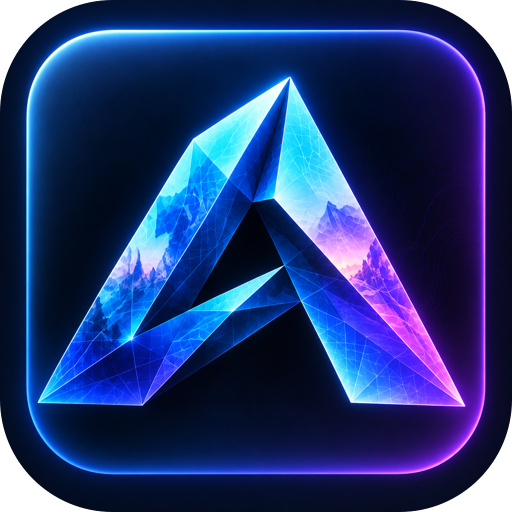
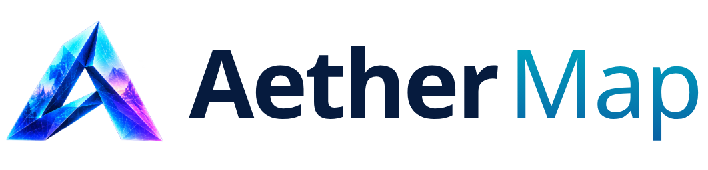
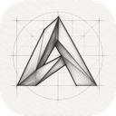
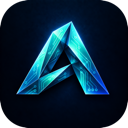

<!-- Product section generated by AetherStudio/dev/site/build_pages.py (apps.py). Edit there; developer notes below the line are kept. -->

> **Alpha 0.1:** [release setup, shared UI and current limitations](ALPHA_0_1.md). Fetch the checksum-locked vendor packages before installing dependencies.

<p align="center"></p>

<h1 align="center">
  <picture>
    <source media="(prefers-color-scheme: dark)" srcset="assets/branding/aether-map-wordmark-dark.png">
    
  </picture>
</h1>

<p align="center">Projection mapping and unattended show playback on Raspberry Pi players.</p>

<p align="center">
  
  
  <a href="https://jenkinsrobotics.github.io/Aether-Map/"></a>
</p>

Warp video, shaders and effects onto real buildings, sets and props in the browser, perform it live with faders and MIDI, then deploy the show to Raspberry Pi players that run it unattended — even with the network unplugged. An open alternative to MadMapper and Resolume.

> **Alpha 0.1 — early access.** Aether Map is alpha software: features are incomplete,
> file formats may change between alphas, and it is not yet qualified for production
> work. Every feature below is marked as working today, in progress or planned.

## Features

### Works today

- ✅ **Surfaces and masks** — Quads, curves and shapes with corner warp, welded corners, masks and cutouts, cube and box groups, and precise numeric controls.
- ✅ **Scenes and timelines** — Per-surface timelines, a reusable media pool, cue tracks and an audio mixer that belongs to the timeline.
- ✅ **Effects and shaders** — An effects library and shaders with parameter motion, body modulation and a visual gallery.
- ✅ **Perform live** — Full-window performance faders with automation takeover, locks and undo, and MIDI controllers with feedback.
- ✅ **Raspberry Pi players** — A Wi-Fi setup wizard, pairing, authorised deployment and offline playback with atomic, retrying updates.
- ✅ **Exports** — Show ZIP and wireframe SVG exports with the exact document and referenced media.

### In progress

- 🔨 **More receivers** — Android TV receiver, QR pairing and more reliable live casting.
- 🔨 **3D pose mapping** — Three linked faces posed in 3D, including inside room corners.
- 🔨 **Online assets and keying** — Online visual libraries and green-screen keying.
- 🔨 **Hardware qualification** — Physical Pi boot, Wi-Fi, output and power-loss acceptance.

### Planned

- 🗺️ **Edge blending** — Soft-edge blending across overlapping projectors.
- 🗺️ **Audio-reactive visuals** — Drive effects from live audio.
- 🗺️ **Show-wide sync** — One timeline across projection, animation, lighting and audio.

## Built-in AI · Works today

Connect ChatGPT, Claude or Gemini once in Aether Studio (**Plugins → My connections**).
Agents use the app's own commands — validated, undoable and recorded. AI is optional:
nothing you save ever needs it.

- Inspect a show, create scenes and surfaces, size and rotate surfaces, place pool assets on tracks, move and edit clips — on the open show with normal undo and autosave, or on saved shows through the CLI and MCP.
- Agents can request a read-only calibration mask of a scene; composition is evaluated as data, so changes are verifiable.
- The same tools are available from the command line and as MCP tools, with scoped permissions and safe retries.

Example: “Create a surface named Front wall, size it to 800×450 at 100,150, and place the Red asset on its video track.”

## On its own, or with Aether Studio

Aether Map keeps its core features on a single machine. Connect it to
[Aether Studio](https://jenkinsrobotics.github.io/AetherStudio/), your own server, and it gains what a
team needs: access from any device, built-in AI, PDM with versions, branches and
releases, and multi-user sharing, comments and tasks. Shows and media live in Drive; Studio pairs and deploys players across the venue network and tracks which show each output runs.

## What every Aether app brings

- **Runs on its own.** Open an app on one machine and work locally. Your files stay on your disk in open, documented formats. _(local install today · downloadable desktop app planned)_
- **Or on your own server.** Point the apps at an Aether Studio server — a Mac Studio in the office or a rack of machines — and the whole team works from one place.
- **Any device.** Every app is a web app first, so laptops, desktops and tablets connect through a browser — no install on the client. _(desktop downloads planned)_
- **Built-in AI.** Connect ChatGPT, Claude or Gemini once in Studio. Each app's AI advisor edits your open document with the app's own tools — and AI is never required to open or play your work.
- **PDM and version control.** Versions, branches, releases and obsolescence for every document, with a visual version graph and restore.
- **Multi-user.** One account across every app, shared workspaces, permissions, comments and tasks. _(real-time co-editing in progress)_
- **Command line and MCP.** Every agent tool is also a CLI command and an MCP tool, with scoped grants, revision guards and retry receipts.
- **Open source.** Apache-2.0. Own your tools, your files and your server.

## Roadmap

| Release | Focus | What it means |
|---|---|---|
| Alpha 0.1 | Author and play | Surfaces, timelines, effects, live performance controls and offline Pi playback. |
| Alpha 0.2 | More outputs | Android TV, QR pairing, live casting and qualified Pi hardware. |
| Beta | Multi-projector | Edge blending and show-wide synchronisation. |

## Get started

```sh
git clone --branch v0.1.0-alpha.1 --single-branch https://github.com/JenkinsRobotics/Aether-Map.git
cd Aether-Map
python3 tools/fetch-vendor.py
```

See [Alpha 0.1 setup and current limits](ALPHA_0_1.md) for frontend build and
server requirements. The web download is a frontend bundle, not a desktop installer.

See the [website](https://jenkinsrobotics.github.io/Aether-Map/) for the full tour.

## The Aether apps

| | App | What it's for | Links |
|---|---|---|---|
|  | Aether CAD | 3D parametric parts, assemblies and production drawings. | [Site](https://jenkinsrobotics.github.io/Aether-CAD/) · [GitHub](https://github.com/JenkinsRobotics/Aether-CAD) |
|  | Aether Animation | Animate characters and animatronics, then play the motion on real servos. | [Site](https://jenkinsrobotics.github.io/Aether-Animation/) · [GitHub](https://github.com/JenkinsRobotics/Aether-Animation) |
|  | **Aether Map** | **Projection mapping and unattended show playback on Raspberry Pi players.** · you are here | [Site](https://jenkinsrobotics.github.io/Aether-Map/) · [GitHub](https://github.com/JenkinsRobotics/Aether-Map) |
|  | Aether Sketch | Drawing and sketching — clean vector paths today, expressive brushes next. | [Site](https://jenkinsrobotics.github.io/Aether-Sketch/) · [GitHub](https://github.com/JenkinsRobotics/Aether-Sketch) |
|  | Aether IO | Electronics and wiring for motion hardware. | [Site](https://jenkinsrobotics.github.io/Aether-IO/) · [GitHub](https://github.com/JenkinsRobotics/Aether-IO) |
|  | Aether Vector | Vector illustration and graphic design. | [Site](https://jenkinsrobotics.github.io/Aether-Vector/) · [GitHub](https://github.com/JenkinsRobotics/Aether-Vector) |
|  | Aether Studio | Your team's server: accounts, shared files, versions and live collaboration. | [Site](https://jenkinsrobotics.github.io/AetherStudio/) · [GitHub](https://github.com/JenkinsRobotics/AetherStudio) |

---

## Developer notes

## GitHub checkout handoff — 2026-10-10

Active development is now in `Aether-Map`. The existing app snapshot was
imported from `Temp Aether` into this GitHub-linked checkout. Source history and
original starter files are preserved there; this checkout keeps its GitHub
history and origin. No upload or running-installation cutover was performed.
Studio (server, Drive and shared packages) lives in `../AetherStudio`.
Earlier migration notes below describe historical folder names.

## Local repository handoff — 2026-10-09

This is the new local development home. The folder split, package boundaries,
setup/build integration and local Git history are complete. The original monorepo
remains the running deployment and historical backup. The GitHub origin is configured; see SOURCE_HISTORY.json.
See [development setup](../AetherStudio/LOCAL_DEVELOPMENT.md) and
[verification](../AetherStudio/migration/LOCAL_STRUCTURE_COMPLETE.md).
The earlier extraction notes below describe the initial snapshot.

# aether-map

Local migration candidate for Aether. Extracted from the current working source,
including uncommitted changes. **Production still uses the original Aether Studio
checkout.** Read `MIGRATION.md` before switching development to this folder.

## Build

Use Node 22.12+ and npm. From `.`:

```sh
npm ci
npm run build
```

Shared Aether packages are versioned archives under `vendor/`, with lockfile
integrity checks. No frontend imports source from the original checkout. Archives
are temporary local distribution until the package registry is configured.
The platform serves these builds using `aether-platform/projects.json`.

The existing product README is retained as `README.pre-split.md` where present.
Some older paths in historical documentation refer to the former monorepo.

## Installed service and player release check

`aether-map-service` 0.2.0a3 includes the Pi player, Wi-Fi setup wizard,
receiver and installer as product-owned package resources. The deployment
archive uses the Map frontend directory configured on the platform host;
it does not assume the service wheel lives beside a source checkout's `dist/`.
Build the frontend and configure its location before deploying to a player.
Node.js is still required for the saved-document agent runtime.

```sh
npm test
npm run build
../AetherStudio/.venv/bin/python -m pytest service/tests player/tests -q
```

The installed-package regression builds a wheel and runs it from an unrelated
folder. It checks the downloadable installer and all embedded modules, shell
syntax, configured renderer contents, missing-build response and authentication.
It does not execute an installer on the development machine. Actual Pi boot,
Wi-Fi pairing, headless playback, mirroring and interrupted deployment still
need hardware acceptance before a full release.

Show playback rules now bind to the selected output's scene independently of
the scene being authored. An unassigned output has no editable duration or
start/seek controls. Rehearsal audio uses the same output binding and schedule
as its preview. Playback settings preserve the authoring scene selection.

Pi updates now stage the renderer, layout and media in a separate release and
atomically switch a local pointer only after successful downloads and writes.
Failed updates preserve the active release and are retried on the next poll.
Legacy caches remain readable; the last generation is retained for in-flight
requests. Cached media uses hard links where supported to avoid copying video.
The kiosk notices a new generation or output assignment and reloads its iframe.
Tests cover failed media/archive/write/publication, retry, restart and local HTTP
serving. These are simulated failures, not physical power-loss guarantees; live
Pi hardware acceptance is still required.

## Platform compatibility and first-release checks

The service ships `compatibility.json` alongside its Python modules. Platform API
identity is validated before service construction. The manifest also pins the
frontend/service versions and exact shared UI/session/sketch/artwork archives.
Change these pins intentionally when updating dependencies; archives are immutable.
This service requires Aether Platform 0.2.0a3 or newer.

From the sibling platform checkout, run
`.venv/bin/python suite.py release --workers 2` for the combined Map/CAD framework
acceptance. This includes production builds, shared UI, permissions/history/agent
regressions, installed-wheel checks, Map playback, and required native CAD document
workflows and engine tests. It writes detailed evidence to `.verification/release/`.
Physical device qualification and offline desktop installation remain separate.

## Native Studio product commands

`npm run build:automation` now emits a self-contained Node worker and a hashed
`native-worker.json` manifest. Both ship in the service wheel. The same
product-owned `automation-commands.json` defines the Python service and native
installation catalogs. Studio can install nine saved-show tools
(inspect, evaluate, scene/surface create, surface bounds/rotate, asset placement, clip move/edit) with scoped grants, revision guards and atomic
retry receipts. The editor semantics remain in Map. These saved-file commands do
not address open editors; the separate provider adapter below does. Device
automation and offline MCP remain outside this catalog. Studio's `crates/server/NATIVE_PRODUCTS.md`
documents installation and limits.

### Live AI advisor editing — 2026-10-13

Open a show, connect a supported agent in Studio **Plugins → My connections**,
then open **AI advisor**. The installed Map build offers11 tools: paged show
inspection, scene composition evaluation, scene/surface creation, surface
bounds/rotation, existing pool-asset placement, clip move/edit, and undo/redo.
For example: “Inspect this show, create a surface named Front wall, size it to
800×450 pixels at100,150, and place the Red pool asset on its video track.”
The asset must already exist; inspect supplies its actual ID and track IDs.

Live and saved adapters call the same `runDocumentCommand` operations. The live
adapter commits through ordinary editor undo and autosave, preserving current
scene/output bindings. Read-only files, locks, active gestures/dialogs, cancelled
requests and changed editor/scene/branch identity are refused. The draft's first
save keeps its chat session. Inspection pages and mutation receipts are bounded;
evaluation returns geometry/audio state, explicitly not a pixel preview.

The native browser gate used a scripted model to create/size a surface, place an
asset, evaluate its actual composition, undo/redo and save/reopen the show. The
full686-test Map suite and18 final focused live/history tests pass; production and
automation builds pass. Actual external-provider sign-in/inference, media import
or creation, arbitrary corner/mesh editing, new playback/device commands and
offline agents are not qualified by this work.


### Native Studio device downloads

After building the web app, `python3 scripts/build-device-distribution.py --output
build/device-distribution-001` creates an immutable six-file installer/player/app
bundle and `map-downloads.json`. Use a new output directory for each release.
Studio's native host can serve a copied, operator-installed bundle through
`AETHER_NATIVE_MAP_DOWNLOADS`; it validates lengths/hashes and snapshots the files.
The existing player and first-run wizard are unchanged. This build step does not
install anything, contact a Pi or prove physical Wi-Fi/boot/output behavior.
Show-specific exports and physical qualification remain separate work.

### Native Studio show exports

The headless automation build now includes the product-owned
`/api/map/project-export` transform in `runtime/native-worker.json`. Installing
that manifest in native Studio enables the existing show ZIP/SVG download URLs.
Map generates wireframe geometry and bundle metadata; Studio supplies an authorized
saved snapshot and packages its exact document bytes and referenced media. The
React UI and the saved-show agent commands keep their existing interfaces.
This does not change the Pi runtime or deploy/restart an installation. Native
qualification and limits are recorded in Studio's `crates/server/MAP_EXPORTS.md`.


### Create mapping structure through CLI/MCP

`map.scene.create` adds a named scene to an **existing saved show**, with required
`width_px` and `height_px` (whole pixels, 1–16384). `map.surface.create` adds a
named empty mapping surface to `scene_id`, centered using the same constructor
as the editor. Both require `app: "map"`, document `id`, and `expected_revision`.
Inspect the show first. Results include `created.scene_id` and, for a surface,
`created.surface_id`, plus the new document revision. Existing editor focus and
output bindings remain unchanged; reload open editors to see saved changes.

The native Rust client accepts, for example, JSON on stdin:

```sh
aether-agent run map.scene.create --operation-id create-side-scene < scene-arguments.json
```

```json
{"app":"map","id":"YOUR_DOCUMENT_ID","expected_revision":1,"name":"Side","width_px":720,"height_px":1280}
```

Use a unique operation ID per intended edit and reuse it only to retry that exact
request. Native Studio receipts return the original IDs without another revision.
The MCP names are `map_scene_create` and `map_surface_create`; native MCP accepts
`params._meta["aether/operationId"]` for the same retry behavior. Content-edit grants
and current file permissions are required. Names are limited to 200 characters;
creation is bounded to 256 scenes and 1024 surfaces per scene. These tools neither
start output playback nor create a new library document. Corner/mesh and media editing
and offline MCP remain separate work. Live provider tools are described below.


### Edit saved mapping geometry

`map.surface.bounds` sets `x_px`, `y_px`, `width_px`, `height_px` for a surface's
visible axis-aligned bounds at mapping time zero. `map.surface.rotate` applies
`delta_degrees` around that visible bounding-box center. Both require `scene_id`,
`surface_id`, `app`, saved document `id` and `expected_revision`. They preserve
content and animation keys and use the editor's transforms for masks and curve
handles. A bounds operation scales the existing shape; it does not replace a
warped quad with a rectangle or add animation keys.

Welded corners move together. `changed_surface_ids` reports affected surfaces,
including welded neighbours. Locked surfaces/neighbours, aspect-ratio-changing
resizes of locked proportions, degenerate transforms and unchanged geometry are
refused without saving. Coordinates are bounded to ±1,000,000 scene pixels,
dimensions to 1–32768 pixels, rotation to ±360 degrees. Aspect-ratio locks apply
to resizing; rotating retains the shape's proportions.

MCP names: `map_surface_bounds`, `map_surface_rotate`. Use native operation IDs
for safe retries, especially rotations. These edit saved mapping geometry only;
they do not move a projector, play a show or update an unsaved editor tab.


### Place an existing asset through CLI/MCP

`map.asset.place` (MCP `map_asset_place`) takes `asset_id`, `track_id` and
`start_s`, plus the usual `app`, document `id` and `expected_revision`. Discover
IDs with `map.show.inspect`. It creates a distinct clip using the editor's source
reference, timing and track targets, returning `created.clip_id`. It rejects
locked/incompatible tracks, missing media, invalid times and clips ending after
604800 seconds; automation is capped at10000 clips per show. Native operation
receipts prevent duplicate placement when retrying the same operation ID.
This places existing pool assets; it does not import files, create assets or
start playback. Open editors must reload saved changes.


Live agents can request `aether_map_mapping_preview` for a scene: a read-only
calibration mask at time zero from the projection exporter. White marks projected
surfaces, black marks outside/cutouts, including curves/warp/alpha masks. This is
not a composed show preview: shaders, media, text, backdrop and audio are excluded.
Use `show_evaluate` for composition data. Changed documents and cancelled requests
cannot deliver stale previews. Shared UI82/native images-v1 support is required;
the image contract is bounded to1024px per edge/256KiB and8 images per turn.
This source capability is not yet promoted to the installed host.


## Online assets and green-screen media (development, 2026-10-13)

In **Visualization → Media Pool → Online Library**, choose Pixabay videos,
Pixabay images or Openverse images. Search a term or paste a Pixabay asset-page
link. Videos open a preview with a resolution selector; **Import into project**
downloads a copy, uploads it through normal project media storage and preserves
its source/creator/license with the same import edit. Downloads have a512MiB cap,
a two-minute deadline and a cancel control. Failed imports are not reported as
success. Drag an imported pool asset onto a timeline or use **Append to track**.

Pixabay search requires a key configured on the native Studio host; see
`../AetherStudio/crates/server/MAP_SEARCH.md`. Openverse still needs no provider
key. **Browse Pixabay** opens its real site in a browser popup. Download there,
then use **Import downloaded file** to choose the file. A web page cannot capture
that other site's downloads into an arbitrary local project/repository directory;
that exact workflow remains desktop-shell work. Hosted imports belong to the
project's Studio media storage, not the source-code checkout. No API credentials
or downloaded asset are embedded in source code.

Select a video/image pool asset and enable **Properties → Green screen → Remove
background color**. Green, blue or a custom color can be keyed. Tolerance controls
removal; edge softness blends the outline and spill suppression reduces colored
fringes. Reusable clips inherit pool settings, while edits in a clip's **Adjust**
properties create its own source override. Save/reopen and exported show documents
retain these settings. Keying uses WebGL before cropping, warping and ordinary
visual effects, in both editor and browser output. It follows the existing show
clock. Keyed render targets are capped at1920×1080 equivalent pixels per instance;
original imported bytes are retained. GPU failure is reported visibly. Webcam
keying, AI background removal, physical-player performance and native download
capture are not included in this feature.

Verification: provider/parser/import/credit and source persistence tests, full
frontend regressions, production/worker builds, native fixture/authority tests,
and a built-browser fixture importing actual WebM bytes, reading transparent GPU
pixels in editor/output and reopening the saved project. Live Pixabay with an
operator API key is not yet qualified. Development files only; the installed
application generation has not been promoted by this work.

### Agent authoring

Map's [agent guide](docs/AGENT_GUIDE.md) covers live editor tools, gallery discovery,
atomic show programs, composition checks, and the bundled local CLI/MCP adapter.
In Simple Visualization, **Agent tools** runs the included working recipe without
requiring a model connection. The Aether Agent panel uses the same operations.

## Android / Google TV receiver candidate — 2026-10-14

[The native TV receiver](player/android/README.md) now builds an installable local
APK with QR/code pairing, direct WebRTC reception, audio control and remote
navigation. The optional verified APK distribution exposes its actual download
from Players → Set up a new one. Studio access schema23 distinguishes live
receivers from standalone Pi players and refuses offline assignment to TVs.
This is a source/build candidate: no physical TV, browser/phone pairing or LAN
playback acceptance is claimed, and the installed suite is unchanged. Evidence:
`.verification/android-tv-2026-10-14/RESULTS.md`.
